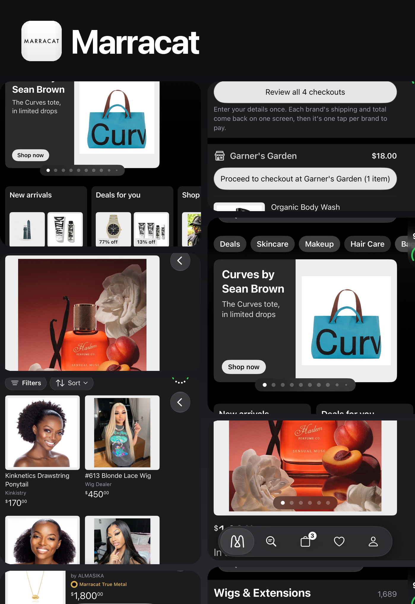
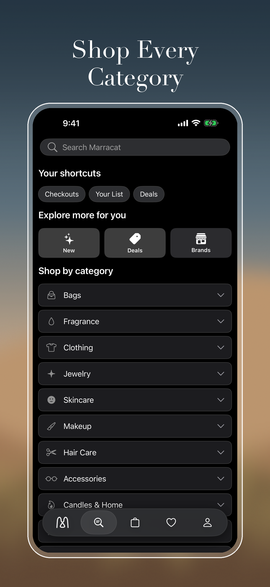
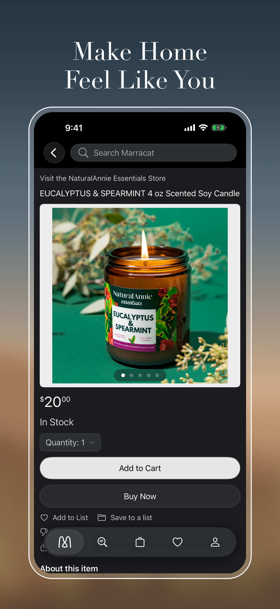
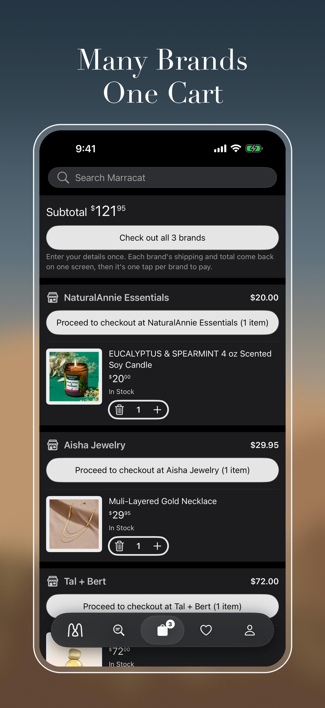

<h1 align="center"> Marracat </h1> <br>
<p align="center">
  <a href="https://marracat.com/">
    
  </a>
</p>

<p align="center">
  Shop independent brands in one app. Built with SwiftUI.
</p>

<p align="center">
  <a href="https://apps.apple.com/us/app/marracat/id6810905687">
    
  </a>
  <br><a href="https://marracat.com/"><b>marracat.com</b></a>
</p>

## Table of Contents

- [Introduction](#introduction)
- [Features](#features)
- [Feedback](#feedback)
- [Build Process](#build-process)
- [How Products Get In](#how-products-get-in)
- [Checkout](#checkout)

## Introduction

Marracat is a shopping app for discovering independent brands and their products. Shoppers search and browse every brand's products in one place, keep one cart, and check out on each brand's own store, so the brand keeps the sale and the customer.

**Available for iPhone and on the web at [marracat.com](https://marracat.com).**

<p align="center">
  
</p>

## Features

A few of the things you can do with Marracat:

* Search every brand's products at once, with spelling help when a search finds nothing
* Browse by category, from skincare and fragrance to bags, clothing and home
* Open a brand's store and see everything it sells
* Keep one cart across brands
* Check out on each brand's own store in a native sheet, with Apple Pay and Shop Pay
* Follow an order after you buy
* Use the app in 18 languages

<p align="center">
  
  
  
  
</p>

## Feedback

Questions and feature requests are always welcome on the [support page](https://marracat.com/#/support).

## Build Process

```sh
xcodegen generate
xcodebuild -project Marracat.xcodeproj -scheme Marracat \
  -destination 'platform=iOS Simulator,name=iPhone 17 Pro' test
```

App icon: `swift scripts/make_icon.swift Marracat/Assets.xcassets/AppIcon.appiconset/icon-1024.png`.

### Ship to TestFlight

One-time: `~/.venvs/marracat/bin/python scripts/register_in_asc.py` registers the
bundle ID; Apple only allows creating the App Store Connect app record in the
dashboard, so the script prints the values to enter, then re-run it to save
`ASC_APP_ID` into the gitignored `scripts/asc-config.env`.

Every build: `SIM_UDID=<free simulator> ./scripts/ship.sh` — smoke launch, UI
tests, build-number bump, archive, export, upload, and the internal TestFlight
group with automatic distribution.

## How Products Get In

`catalog/build_catalog.py` reads each brand's public Shopify feed
(`https://<store>/products.json`), sorts every product into one category by
keyword scoring, and writes `Marracat/Resources/catalog.json`, which ships in the
app bundle. `catalog/report.md` lists per-brand counts and which brands could
not be imported.

```sh
python3 catalog/build_catalog.py           # fetch every store, rebuild
python3 catalog/build_catalog.py --cached  # re-categorise without refetching
```

Add a brand: append it to `catalog/brands.json` and rebuild.

## Checkout

The cart groups items by brand. "Proceed to checkout" opens that brand's
Shopify cart permalink (`/cart/<variant>:<qty>,…`) in Shopify Checkout Kit
(`ShopifyCheckoutSheetKit` 3.8.x) — the brand's own checkout as a native sheet,
with Apple Pay and Shop Pay. A completed order clears that brand from the cart.
If Checkout Kit can't load a store but reports the error as recoverable, the
same URL opens in Safari. UI tests pass `-CHECKOUT_STUB` so they never open real
checkout sessions on brands' stores.

## About this repository

This is a public snapshot of the Marracat codebase, synced from the private
working repository. Internal research, some catalog data and a few internal
tools are left out, and some wording in strings, comments and tests differs,
so parts of the catalog pipeline and a few tests will not run as published.
